<p align="center">
  <picture>
  <source media="(prefers-color-scheme: light)" srcset=".github/assets/banner-light.svg">
  
</picture>
</p>

<p align="center">
  <i>Hardening a small segmented network step by step, from an open baseline to a firewalled, encrypted and monitored setup.</i><br>
  Every control is backed by evidence (captures, logs, scans) and checked by a regression test.
</p>

<p align="center"><sub>Labs from a network security course, February to April 2026. TD6 is the final project that puts everything together.</sub></p>

<p align="center">
<picture>
  <source media="(prefers-color-scheme: light)" srcset=".github/assets/divider-light.svg">
  
</picture>
</p>

<p align="center">
<picture>
  <source media="(prefers-color-scheme: light)" srcset=".github/assets/stats-light.svg">
  
</picture>
</p>

<p align="center">
  <picture>
  <source media="(prefers-color-scheme: light)" srcset=".github/assets/journey-light.svg">
  
</picture>
</p>

<h3>
<picture>
  <source media="(prefers-color-scheme: light)" srcset=".github/assets/h-lab-topology-light.svg">
  
</picture>
</h3>

<p align="center">
<picture>
  <source media="(prefers-color-scheme: light)" srcset=".github/assets/topology-light.svg">
  
</picture>
</p>

TD1 to TD4 use a single gateway between the LAN and the DMZ. The second gateway and the WAN link were added in TD5 for the site-to-site VPN.

**Stack:** nftables, Suricata, nginx/OpenSSL, OpenSSH, strongSwan (IKEv2), tcpdump, nmap, testssl.sh, bash. VMs on VirtualBox/Vagrant, Ubuntu 24.04.

<h3>
<picture>
  <source media="(prefers-color-scheme: light)" srcset=".github/assets/h-what-s-inside-light.svg">
  
</picture>
</h3>

| # | Topic | What I did | Folder |
|---|-------|-----------|--------|
| 1 | Baseline | Mapped assets, zones and expected flows, scanned srv-web, captured reference traffic with tcpdump, wrote a first risk list | [01-network-baseline](01-network-baseline) |
| 2 | Firewall | Turned the flow matrix into an nftables policy (default drop, stateful, allow-list), logged denies, wrote a rollback script, tested allowed and blocked flows | [02-firewall-nftables](02-firewall-nftables) |
| 3 | IDS | Deployed Suricata on a promiscuous sensor, triggered ET rules with nmap, wrote a custom rule for `/admin`, reduced noise with thresholds | [03-ids-suricata](03-ids-suricata) |
| 4 | TLS | Audited a weak nginx TLS config, removed TLS 1.0/1.1 and CBC suites, added HSTS, rate limiting and User-Agent filtering, then audited again | [04-tls-nginx](04-tls-nginx) |
| 5 | Remote access | Key-only SSH (no root, `AllowUsers`), site-to-site IPsec tunnel with strongSwan, checked with tcpdump that only ESP goes over the WAN | [05-ssh-ipsec](05-ssh-ipsec) |
| 6 | Final pack | Merged all controls, threat model, risk register, 30/60/90 plan, executive summary and an automated regression suite | [06-final-hardening-pack](06-final-hardening-pack) |

<details>
<summary><b>Folder layout</b>: every TD follows the same structure</summary>

```
README.md          what was done and how to reproduce it
report.md          analysis and results
config/            configs actually applied on the VMs
evidence/          raw outputs (before / after)
tests/             commands and test cards
appendix/          failure modes I ran into and how I fixed them
```

</details>

<h3>
<picture>
  <source media="(prefers-color-scheme: light)" srcset=".github/assets/h-before-after-light.svg">
  
</picture>
</h3>

| Area | Baseline | After hardening |
|------|----------|-----------------|
| Filtering | none, everything routed | default drop on gw-fw, only HTTPS (8443) and SSH allowed LAN to DMZ |
| TLS | TLS 1.0/1.1 accepted, CBC ciphers, no HSTS | TLS 1.2/1.3 only, ECDHE + AES-GCM, HSTS |
| SSH | password login, root allowed | ED25519 keys only, `admin1` only, `MaxAuthTries 3` |
| Inter-site traffic | cleartext | IPsec ESP, AES-256 / SHA-256 / MODP-2048 |
| Detection | none | Suricata with 3 custom rules (SID 9000001 to 9000003) on `/admin`, MySQL scans and SSH brute force |

<h3>
<picture>
  <source media="(prefers-color-scheme: light)" srcset=".github/assets/h-regression-tests-light.svg">
  
</picture>
</h3>

The final pack has one script per control. They are meant to be run from the `client` VM:

```bash
cd 06-final-hardening-pack
bash tests/regression/run_all.sh
```

| Test | Checks |
|------|--------|
| R1_firewall.sh | HTTPS on 8443 goes through, MySQL (3306) is dropped |
| R2_tls.sh | TLS 1.2 is accepted, TLS 1.0 is rejected, HSTS header is present |
| R3_remote_access.sh | key login works, login without key is refused, IPsec tunnel is established |
| R4_detection.sh | a request to `/admin` raises a new alert with SID 9000001 |

Results are written to `tests/regression/results/<timestamp>/`. The run `20260322_235312` passes 4/4. The two other runs were done with the first version of the scripts (a missing `$` in a variable and `sudo` over ssh without a TTY) and are kept on purpose.

<p align="center">
<picture>
  <source media="(prefers-color-scheme: light)" srcset=".github/assets/divider-light.svg">
  
</picture>
</p>

<h3>
<picture>
  <source media="(prefers-color-scheme: light)" srcset=".github/assets/h-known-limits-light.svg">
  
</picture>
</h3>

This was coursework and I know it is not perfect. Looking back, a few things are clearly weaker than they should be:

- the documentation is uneven, some reports go much deeper than others
- the regression tests check that each control is in place, they are not a real attack on the whole setup

Some shortcuts were also taken on purpose because it is a lab. They are listed in the [risk register](06-final-hardening-pack/report/Risk_Register.md):

- self-signed certificate and a short HSTS `max-age` (300s)
- static IPsec PSK instead of certificates (the PSK is redacted in this repo)
- Suricata in IDS mode only, no inline blocking
- no fail2ban or central logging yet

The [30/60/90 plan](06-final-hardening-pack/report/30_60_90_Plan.md) describes how I would handle them in a real environment.

<h3>
<picture>
  <source media="(prefers-color-scheme: light)" srcset=".github/assets/h-scope-light.svg">
  
</picture>
</h3>

All scans and tests were run only against VMs of the lab environment.
